# 你好，我是 tfiyw-wei 👋

点击终端，打开我的个人作品集 ↗

**AI 产品探索 · 交互原型**

我喜欢从具体的使用场景出发，把想法做成可以点击、体验和继续迭代的作品。  
在这里，记录我对 AI 产品、交互设计与网页体验的探索。

🌐 [个人网站](https://tfiyw-wei.github.io/personal-website/) · [查看所有项目](https://github.com/tfiyw-wei?tab=repositories) · 📕 [小红书](https://www.xiaohongshu.com/user/profile/5b55ea34f7e8b907ecbd300a) · ✉️ [邮箱](mailto:179369971@qq.com)

---

## ✦ 精选项目

### [饿了么 · 这一口，就是现在](https://github.com/tfiyw-wei/eleme-motion-landing-page)

围绕「今天吃什么」展开的品牌体验概念作品：从美食发现、场景切换，到点餐筛选与配送演示，把一段使用流程做成可交互的原型。

`场景设计` `交互原型` `HTML / CSS / JavaScript`

[在线体验 ↗](https://tfiyw-wei.github.io/eleme-motion-landing-page/) · [查看源码](https://github.com/tfiyw-wei/eleme-motion-landing-page)

非官方概念作品。点餐助手使用本地示例菜单与规则筛选，未接入真实 AI 模型或交易系统。

### [Personal Website · 个人作品集](https://github.com/tfiyw-wei/personal-website)

浅色连续布局的个人作品集，通过顶部导航浏览作品展示、探索清单与联系方式。支持快捷导航与邮箱复制，也保留了可编辑的个人介绍页模板。

`个人作品集` `浅色长页` `HTML / CSS / JavaScript`

[访问网站 ↗](https://tfiyw-wei.github.io/personal-website/) · [查看源码](https://github.com/tfiyw-wei/personal-website)

---

## ↗ 持续探索

- **AI 产品**：从真实场景理解需求，思考 AI 能在哪一步提供帮助。
- **交互原型**：把抽象想法变成可操作的流程，让体验和反馈帮助下一次迭代。
- **网页体验**：探索视觉叙事、动效与响应式布局之间的配合。

从一个小想法开始，做出可以体验的下一步。
